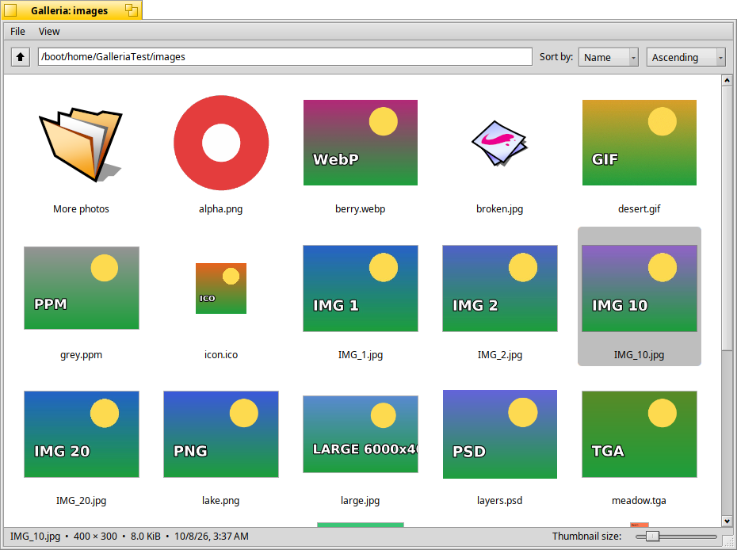
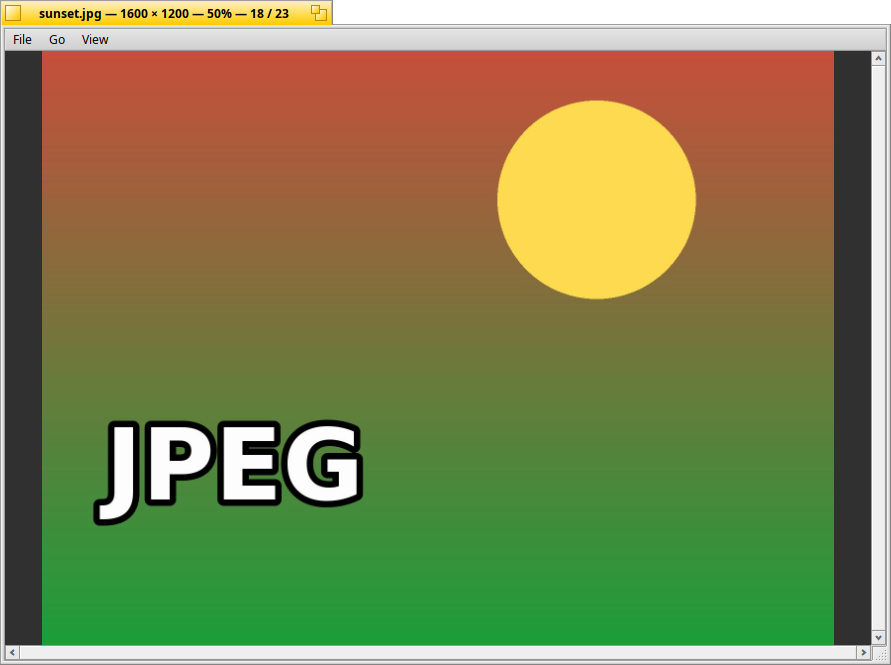

# Galleria

A no-frills image browser and viewer for Haiku, written with the native
Haiku API. In the spirit of Gwenview: a folder of thumbnails, and a viewer
window for the image you open.

## Features

**Browser**

- Folder shown as a grid of thumbnails, with subfolders first.
- Slider at the bottom for the thumbnail size (48 to 512 pixels); Ctrl +
  mouse wheel and Command +/- do the same.
- Sort by name (natural order: `IMG_2` before `IMG_10`), modification date,
  creation date, size or type, ascending or descending: from the drop-down
  menus in the toolbar or the View menu.
- Location field (type a path, `~` works), parent folder button
  (Command + Up, or Backspace), File > Open folder, and folders or images
  dropped from Tracker.
- The folder is watched: new, renamed and deleted files show up by
  themselves.
- The status line shows the selected image's dimensions, size and date.
- Right-click: Open, Open in new window, Show in Tracker.

**Viewer**

- Images open in their own window. Double-click (or Enter) reuses the viewer
  window; "Open in new window" in the context menu opens another one.
- The mouse wheel and trackpad scroll the image up and down (Shift scrolls
  sideways); drag with the mouse to pan.
- Zoom in and out (Command + / -, plain + / -, or Ctrl + mouse wheel around
  the pointer), Original size (1), Fit to window (F), Fit width (W) and an
  option to enlarge small images when fitting. **The zoom sticks:** the next
  image, and the next start of Galleria, use the zoom you chose last.
- Left/Right, Space/Backspace, Home/End go through the images of the folder in
  the browser's sort order; the browser selection follows.
- Full screen with Enter, F11, Command + F or a double-click; Escape leaves
  full screen (or closes the viewer).
- The next image is decoded in the background, so stepping through a folder
  is quick; strongly reduced images are drawn from properly filtered
  half-size copies, not just sampled.

**Keyboard**

| Browser | |
|---|---|
| Arrow keys, Page Up/Down, Home/End | move the selection |
| Enter (or double-click) | open the image or folder |
| Backspace, Command + Up | parent folder |
| Command + `+` / `-`, Ctrl + wheel | larger / smaller thumbnails |
| Command + O, Command + R | open folder, reload |

| Viewer | |
|---|---|
| Right, Space / Left, Backspace | next / previous image |
| Home / End | first / last image |
| Up/Down, Page Up/Down, wheel | scroll (Shift + wheel: sideways) |
| `+` / `-`, Ctrl + wheel | zoom in / out |
| `1`, `F`, `W` | original size, fit to window, fit width |
| Enter, F11, double-click | full screen |
| Escape | leave full screen, or close the viewer |
| Command + B | show the image in the browser |

**Formats**

Galleria reads whatever the installed Translation Kit translators read. On a
standard Haiku that is JPEG, PNG, GIF, BMP, TIFF, WebP, AVIF, JPEG 2000, TGA,
PSD, PCX, PPM, SGI, ICO, ICNS, camera RAW, HVIF and WonderBrush. JPEG EXIF
orientation is applied. Installing more translators adds more formats.

## Thumbnail cache

All thumbnails are stored in one folder:

    ~/config/cache/Galleria

Delete it at any time, with **File > Clear thumbnail cache…** or simply
`rm -r ~/config/cache/Galleria`; thumbnails are made again when needed.

Inside are PNG files in one folder per size class (`128`, `256`, `512`), named
after a hash of the image's path. Attributes on each PNG record the image's
path, size and modification time, so a changed image gets a new thumbnail.
Images that are no larger than the thumbnail are not cached at all.

Settings are in `~/config/settings/Galleria settings`.

## Building

On Haiku, with the `haiku_devel` package installed:

    make

The application is `objects.x86_64-cc13-release/Galleria`. To build the
package:

    bash package/build-package.sh
    pkgman install package/galleria-1.0.0-3-x86_64.hpkg

The package puts Galleria in the Deskbar's Applications menu. Galleria also
appears in Tracker's "Open with" menu for images and folders.

The icon is generated: `python3 tools/make_icon.py` writes
`artwork/Galleria.hvif`; `tests/render_icon.cpp` renders it at several sizes
into a PNG for checking.

## Source overview

| File | What it does |
|---|---|
| `src/App.cpp` | Application: windows, command line and Tracker launches |
| `src/BrowserWindow.cpp` | Browser window: menus, toolbar, folder scanning and watching, status line |
| `src/ThumbnailView.cpp` | The thumbnail grid: layout, drawing, selection, lazy loading |
| `src/ThumbnailLoader.cpp` | Worker threads that make thumbnails, and the disk cache |
| `src/ViewerWindow.cpp` | Viewer window: navigation, zoom, full screen, image cache |
| `src/ImageView.cpp` | Draws the image, scrolling, panning, zooming |
| `src/ImageLoader.cpp` | Background decoding with prefetch, half-size levels |
| `src/ImageFile.cpp` | Which files are images, folder scanning, sorting, loading, scaling |
| `src/Settings.cpp` | Settings shared by all windows |
| `src/WorkerThread.cpp` | Threads with a stack large enough for every translator |

## Testing

`tests/gui-test.sh` drives the application with `hey` on Haiku and checks
browsing, every sort order, thumbnail sizes and the cache, live folder
updates, the viewer (zoom stickiness, wheel scrolling, fit modes, full
screen), the keyboard, the zoom button and window resizing, launching with an
image and persistence of the settings:

    python3 tests/make-test-images.py /tmp/images      # on a machine with Pillow
    bash tests/gui-test.sh objects.x86_64-cc13-release/Galleria /path/to/images

`tests/big-folder-test.sh` times a folder of 600 images (cold and cached
thumbnails), `tests/cache-check.sh` repeats cold starts and lists images that
were not cached, `tests/zoom-check.sh` and `tests/resize-check.sh` show how
the zoom button and resizing behave with your own settings file, and
`tests/sendkey.cpp` types keys into a window for the keyboard checks.

Every command in the menus can also be sent with `hey` (see the message
codes in `src/Galleria.h`); `hey Galleria Gsta of Window 0` returns a
window's state.

## License

MIT, see `LICENSE`.
